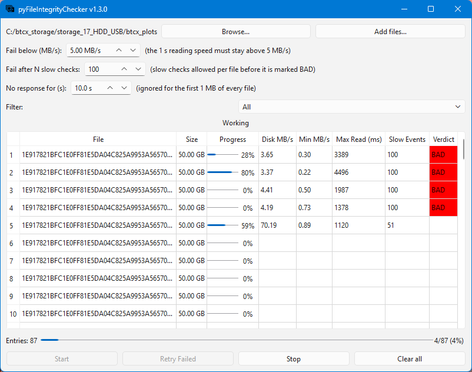

# pyFileIntegrityChecker
Simple python application that can check the integrity of files.

The storage medium of the files does not matter, it can be an HDD, SSD or even a network drive.

## Highlights:
- able to select the folder containing the files to check directly in the GUI
- one parameter decides the verdict: the read speed below which a chunk counts as slow
- easy way to visualise all the files to be checked and various statistics about the checking progress (the actual progress, current disk speed, minimum speed, longest read ...)
- easy way to filter through the files by verdict
- able to start/ stop the checking process at any time
- the progress is saved every 2 seconds so you will never loose the checking progress, even if the computer crashes

# GUI layout

# Support
Found this project useful? Send your ❤ in any form you can 🙂. Please contact me if you donated and want to be added to the contributors list !

- chia XCH---xch1glz7ufrfw9xfp5rnlxxh9mt9vk9yc8yjseet5c6u0mmykq8cpseqna6494
